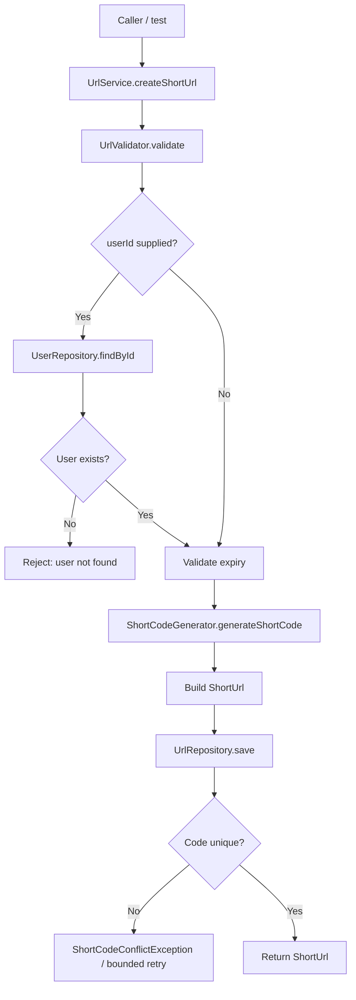
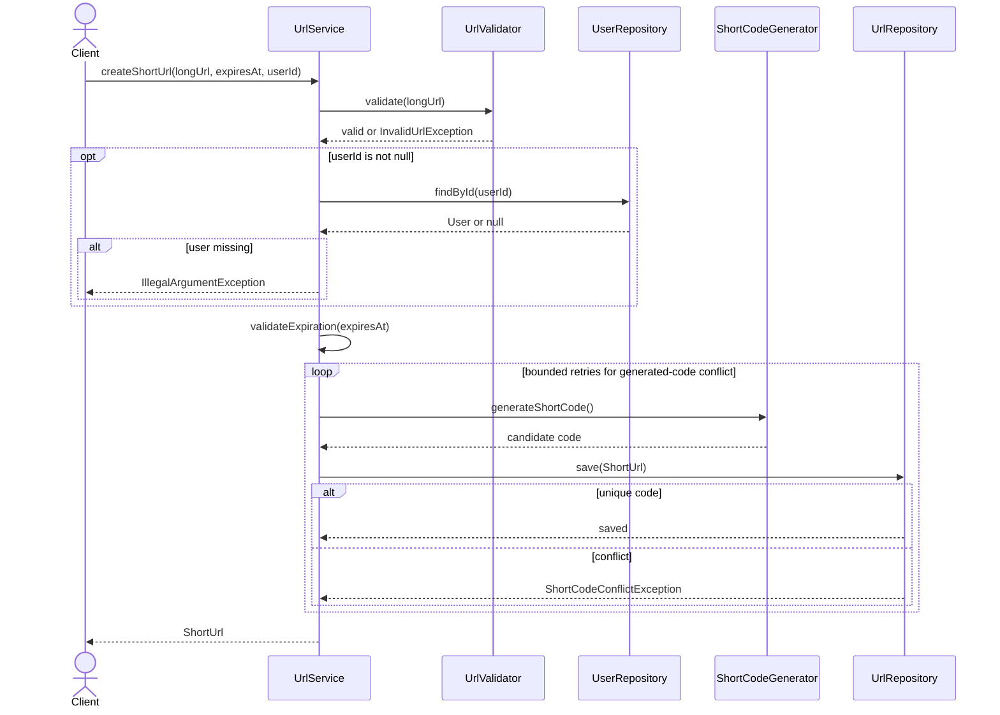
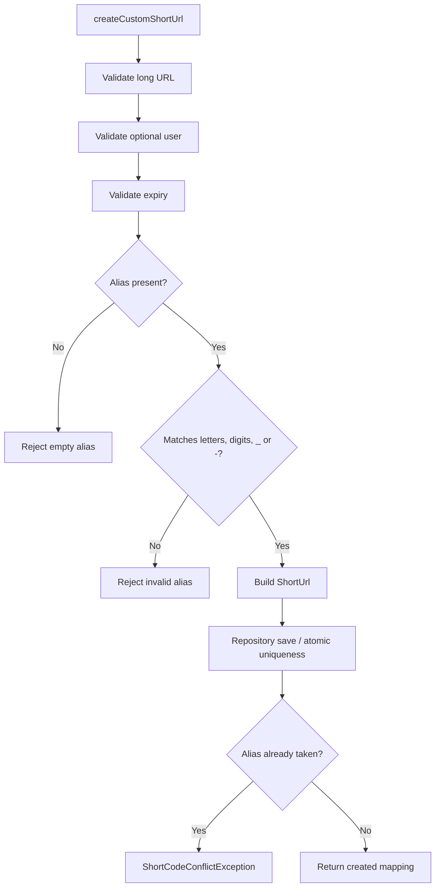
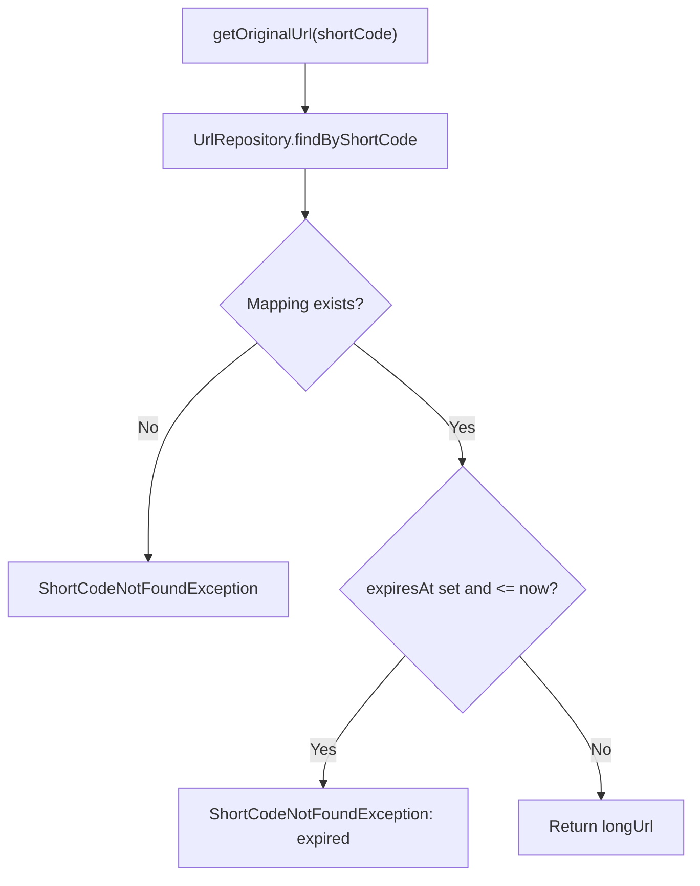
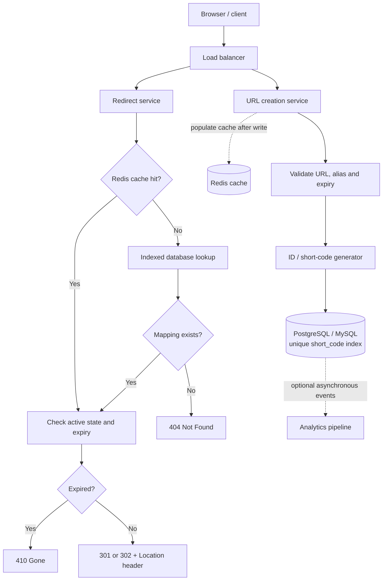
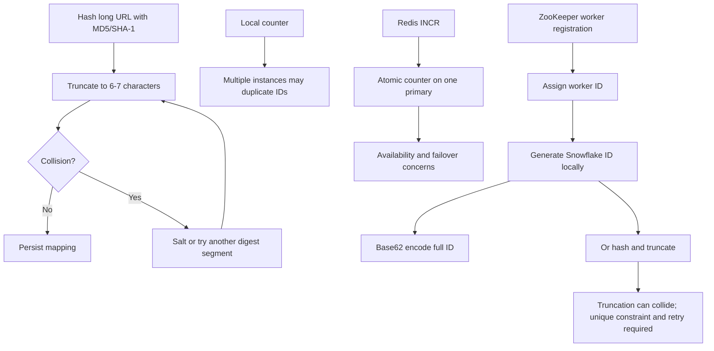

# 🔗 URL Shortener — Low-Level Design (LLD)

> **Plain Java + Maven learning project**
>
> This README combines the URL-shortener video's design progression with the code discussed in this project. It clearly distinguishes the current in-memory implementation from production architecture ideas.

> [!IMPORTANT]
> Redis, PostgreSQL, ZooKeeper, Snowflake, HTTP redirects, and analytics are discussed as production-design options; do not treat them as implemented unless they exist in the source code.

## 📚 Table of Contents

- [1. Requirements](#1-requirements)
- [2. Current implementation](#2-current-implementation)
- [3. Components and packages](#3-components-and-packages)
- [4. Complete flow diagrams](#4-complete-flow-diagrams)
- [5. Create URL flow](#5-create-url-flow)
- [6. Custom alias flow](#6-custom-alias-flow)
- [7. Redirect flow](#7-redirect-flow)
- [8. Concurrency and uniqueness](#8-concurrency-and-uniqueness)
- [9. Video: code-generation evolution](#9-video-code-generation-evolution)
- [10. Cache, expiration, and HTTP redirects](#10-cache-expiration-and-http-redirects)
- [11. Exceptions and status codes](#11-exceptions-and-status-codes)
- [12. Tests and commands](#12-tests-and-commands)
- [13. Interview walkthrough](#13-interview-walkthrough)
- [14. Scope and next steps](#14-scope-and-next-steps)

---

## 1. Requirements

### Functional

1. Create a short URL from a valid HTTP/HTTPS URL.
2. Resolve a short code to the original URL.
3. Optionally associate a short URL with a user.
4. Optionally set an expiration time.
5. Allow custom aliases.
6. Reject duplicate codes/aliases rather than overwrite existing mappings.
7. Reject unknown codes, expired URLs, invalid destinations, past expiry times, and unknown user IDs.

### Non-functional assumptions from the video

- Target low latency (the video uses about 200 ms as an example).
- The video discusses example scale of 100 million daily active users and 1 billion URLs.
- Redirect traffic is expected to exceed creation traffic; the video illustrates an example 80% redirects / 20% creations. These are interview assumptions, not measurements of this project.
- Use horizontal scaling, indexed storage, and caching in the production design.
- Maintain mapping correctness and uniqueness under concurrent requests.

## 2. Current implementation

The current project is a **plain Java + Maven LLD**, not a Spring Boot application. It uses service classes, repository interfaces, in-memory repositories and JUnit 5 tests.

| Feature | Current code | Production/video design |
|---|---|---|
| API | Java method calls | REST endpoints |
| URL storage | `ConcurrentHashMap`-based repository | PostgreSQL/MySQL |
| Cache | Not implemented | Redis cache-aside |
| Code generation | Pluggable generator; Base62 counter/random strategies | Hash/counters, then ZooKeeper worker registration + Snowflake explored |
| User | In-memory `User` and `UserRepository` | Persistent user/account data |
| Expiration | Service validates expiry during creation and resolution | DB expiry, cache TTL, cleanup job |
| Concurrency | Atomic map insertion can prevent duplicate keys in one JVM | DB unique constraint and distributed ID generation |
| Analytics/authentication | Not implemented | Optional analytics and user authorization |

Do not describe Redis, PostgreSQL, ZooKeeper, Snowflake, HTTP redirects or analytics as implemented unless they have actually been added to the source code.

## 3. Components and packages

Package paths below reflect the code discussed in this project; verify against the actual source tree if a class has been moved.

```text
src/
├── main/java/org/example/
│   ├── models/
│   │   ├── ShortUrl.java
│   │   └── User.java
│   ├── repositories/
│   │   ├── UrlRepository.java
│   │   ├── InMemoryUrlRepository.java
│   │   ├── UserRepository.java
│   │   └── InMemoryUserRepository.java
│   ├── service/
│   │   └── UrlService.java
│   ├── service/strategy/
│   │   └── Base62ShortCodeGenerator.java
│   ├── service/
│   │   ├── ShortCodeGenerator.java
│   │   └── UrlValidator.java
│   └── exceptions/
│       ├── InvalidUrlException.java
│       ├── ShortCodeConflictException.java
│       ├── ShortCodeNotFoundException.java
│       └── UserAlreadyExistsException.java
└── test/java/org/example/service/
    └── UrlServiceTest.java
```

Other generator discussed: `RandomShortCodeGenerator`.

### Responsibilities

| Class/interface | Responsibility |
|---|---|
| `UrlService` | Orchestrates validation, user checks, expiry checks, code generation, persistence, and resolving |
| `UrlRepository` | Contract to save a mapping and find it by short code |
| `InMemoryUrlRepository` | In-memory storage; atomically rejects duplicate codes |
| `UserRepository` | Contract for saving and looking up users |
| `InMemoryUserRepository` | In-memory user lookup and duplicate-email checks |
| `ShortCodeGenerator` | Strategy interface for generating candidate codes |
| `Base62ShortCodeGenerator` | Base62 codes from an atomic counter |
| `RandomShortCodeGenerator` | Random code candidates; collisions remain possible |
| `UrlValidator` | Validates destination URL |
| `ShortUrl` | `shortCode`, `longUrl`, `expiresAt`, optional `userId` |
| `User` | `id`, `name`, `email` |

The current `ShortUrl` constructor is expected to be:

```java
new ShortUrl(shortCode, longUrl, expiresAt, userId);
```

### Design principles

- **Repository Pattern:** service depends on interfaces, not concrete storage.
- **Dependency Inversion:** dependencies are injected through the `UrlService` constructor.
- **Strategy Pattern:** swap short-code generators without rewriting URL logic.
- **Single Responsibility:** validation, generation, storage and orchestration are separate concerns.

## 4. Complete flow diagrams

### 4.1 Current implementation: create URL



### 4.2 Create URL: sequence diagram



### 4.3 Custom alias flow



The 3-argument custom-alias overload should delegate to the 4-argument overload with `userId = null`. A caller that wants an owned alias passes a user ID.

### 4.4 Current redirect/resolve flow



### 4.5 Video's scalable high-level architecture



This diagram describes the video's target architecture, not the current in-memory implementation. On cache miss, read from the DB; on Redis outage, fall back to the DB if possible. Cache invalidation is required after updates, disables or deletes.

### 4.6 Code-generation evolution from the video



## 5. Create URL flow

1. Caller invokes `createShortUrl(longUrl, expiresAt, userId)`.
2. `UrlValidator` rejects missing, malformed or non-HTTP/HTTPS URLs.
3. If `userId` is non-null, `UserRepository.findById(userId)` must find the user.
4. If `expiresAt` is non-null, it must be in the future.
5. `ShortCodeGenerator` generates a candidate.
6. Service constructs `ShortUrl(shortCode, longUrl, expiresAt, userId)`.
7. Repository saves it, atomically rejecting duplicates.
8. Service returns the mapping.

`createShortUrl(longUrl)` delegates with null expiry and null user ID, so anonymous URL creation is supported if that is the intended policy.

## 6. Custom alias flow

- Validate the long URL.
- Validate the optional user ID.
- Validate expiration.
- Reject blank aliases.
- Current allowed pattern: `[a-zA-Z0-9_-]+`.
- Build a `ShortUrl` with the requested alias.
- Save through the repository; never overwrite an existing alias.
- A duplicate custom alias should raise `ShortCodeConflictException`.

If custom aliases are a premium feature, authorization/entitlement checks must be added before saving; that is not currently implemented.

## 7. Redirect flow

Current `getOriginalUrl(shortCode)`:

1. Fetch the mapping through `UrlRepository`.
2. Throw `ShortCodeNotFoundException` if absent.
3. If expiry exists and is not after the current time, reject the mapping.
4. Otherwise return `longUrl`.

The current plain Java project does not itself issue HTTP redirects. A REST controller would use the returned URL as the `Location` header in a 301/302 response.

## 8. Concurrency and uniqueness

### Current protections

- `ConcurrentHashMap` supports concurrent map operations.
- `putIfAbsent` atomically claims a key; `InMemoryUrlRepository.save()` should use it and throw `ShortCodeConflictException` if the key is already present.
- `AtomicLong` makes increments thread-safe within one generator instance.
- Random code generators can collide; the repository is the final authority for uniqueness.

### Why check-then-save alone is unsafe

```java
if (repository.findByShortCode(code) == null) {
    repository.save(shortUrl);
}
```

Two threads can both observe no existing value and then try to save the same code. A prior read is not a lock. Atomic insertion (`putIfAbsent`) or a database unique constraint must decide the winner.

### Multi-instance limitation

`ConcurrentHashMap` and a local `AtomicLong` protect only one JVM. They do not coordinate multiple servers. A distributed deployment needs a globally safe ID strategy plus a persistent unique constraint.

### User repository caveat

If `InMemoryUserRepository` updates an ID map and an email map separately, those two writes are not automatically one atomic transaction. For stronger guarantees, synchronize the operation or use a database transaction and unique email constraint.

## 9. Video: code-generation evolution

### Hash and truncate

The video first explores hashing the URL with MD5/SHA-1 and taking 6–7 characters. MD5 commonly appears as 32 hexadecimal characters; SHA-1 as 40. On collision, add a salt or try another digest segment and retry.

**Important:** hashing is not encryption. A digest cannot be decrypted to recover the URL; the mapping must be stored. MD5/SHA-1 are not recommended for modern collision resistance, and truncating any digest can collide. Always enforce uniqueness and handle collisions.

### Local counter

A process generates `1, 2, 3, ...`. Separate application instances can generate the same values.

### Redis counter

Redis `INCR` is atomic for a key on one primary and can provide a shared counter, but ID allocation depends on Redis availability and durability/failover behavior.

### Redis Cluster

Redis Cluster provides sharding/failover but does not magically guarantee every global-counter property. A key belongs to one shard; consider replication, persistence and whether acknowledged increments can be lost during failover.

### ZooKeeper worker registration + Snowflake ID

The video describes assigning worker IDs through ZooKeeper and then generating IDs locally. Its conceptual 64-bit layout is:

```text
[sign bit][41-bit timestamp][10-bit worker ID][12-bit sequence]
id = (timestampDelta << 22) | (workerId << 12) | sequence
```

- Timestamp separates time units.
- Worker ID separates application instances.
- Sequence separates IDs from one worker within the same time unit.
- ZooKeeper is used for worker registration, not every URL creation.
- Handle worker reassignment, sequence overflow and clock rollback.

The video proposes hashing a unique Snowflake ID and truncating it. Truncation can still collide. Direct Base62 encoding of the full unique ID avoids that hash-prefix collision, assuming the Snowflake generator itself is correct.

For the interview, present the progression: hash collision → local counter duplicates → Redis atomic counter and availability trade-off → Redis Cluster nuance → ZooKeeper worker registration + Snowflake. Then explain the truncated-hash caveat.

## 10. Cache, expiration, and HTTP redirects

### Expiration

- Store `expiresAt`.
- Check expiration during every redirect/resolve, not only at creation.
- A background job may delete expired records in batches.
- Do not casually reuse expired codes: old shared links could point to a new destination.

### Future cache-aside redirect

```text
GET /{shortCode}
  -> Redis GET url:{shortCode}
     -> hit: check active/expiry -> redirect
     -> miss: indexed DB lookup
          -> absent: 404
          -> expired: 410
          -> active: populate Redis -> redirect
```

- A 24-hour TTL is only an example starting policy.
- Never set TTL beyond the mapping's remaining lifetime.
- Populate cache after successful writes.
- Invalidate cache after update/delete/disable.
- If Redis is down but DB is available, fall back to DB.
- If required storage is unavailable and no trusted cache entry exists, return service unavailable.

### 301 versus 302

- **301 Moved Permanently:** browsers/proxies may cache it, reducing repeat service traffic but potentially reducing click tracking.
- **302 Found:** useful when future clicks should continue reaching the service for analytics.
- Choose based on product requirements, caching behavior and analytics needs.

## 11. Exceptions and status codes

The Java project throws exceptions; HTTP status codes below are a proposed REST mapping, not current controller behavior.

| Condition / exception | Typical HTTP status |
|---|---|
| Invalid URL | `400 Bad Request` |
| Empty/invalid alias or past expiry | `400 Bad Request` |
| Unknown user ID | `400` or `404`, depending on API policy |
| Duplicate code/alias (`ShortCodeConflictException`) | `409 Conflict` |
| Unknown code (`ShortCodeNotFoundException`) | `404 Not Found` |
| Expired mapping | `410 Gone` if distinguished from unknown |
| ID generation exhausted / required dependency unavailable | `503 Service Unavailable` |
| Authentication missing/invalid | `401 Unauthorized` |
| Authenticated user lacks permission | `403 Forbidden` |
| Rate limit exceeded | `429 Too Many Requests` |
| Unexpected server error | `500 Internal Server Error` |

Current exception classes discussed: `InvalidUrlException`, `ShortCodeConflictException`, `ShortCodeNotFoundException`, and `UserAlreadyExistsException`. Some validations currently use `IllegalArgumentException`. A future REST layer can introduce dedicated alias/expiry exceptions and a global exception handler.

## 12. Tests and commands

The current `UrlServiceTest` covers:

- Create a short URL for a user.
- Retrieve the original URL.
- Reject an unknown code.
- Reject an invalid URL.
- Create a custom alias.
- Reject a duplicate custom alias.
- Reject past expiration.
- Reject expired URLs during lookup.
- Reject unknown user IDs.

Run:

```bash
mvn clean test
```

For a concurrency test, launch many concurrent create calls and assert that every successful mapping has a unique short code, no existing mapping is overwritten, retries are bounded, and exhausted retries fail explicitly. Test the atomic repository insertion path, not just the generator.

This is a plain Java Maven project. To run manually, instantiate `InMemoryUrlRepository`, `InMemoryUserRepository`, a `ShortCodeGenerator`, `UrlValidator`, and `UrlService`, then call the service methods from a `main` method or JUnit tests. Confirm the actual `pom.xml` Java release setting; the project discussed earlier targeted Java 21.

## 13. Interview walkthrough

1. Requirements: create, redirect, aliases, expiry, scale, latency.
2. Entities: `User` and `ShortUrl` mapping.
3. APIs: `POST /api/v1/urls`, `GET /{shortCode}`.
4. HLD: load balancer, creation/redirect services, cache, database, optional analytics.
5. Hash/truncate and collision risk.
6. Local counter and multi-instance duplicate risk.
7. Redis `INCR`, availability and failover concerns.
8. ZooKeeper worker registration and Snowflake timestamp/worker/sequence fields.
9. Explain why a truncated hash of a unique ID can still collide.
10. Cache-aside lookup, expiry, TTL, index on short code.
11. 301 versus 302 for caching and click tracking.
12. LLD patterns: repository, strategy, dependency inversion, validation and tests.
13. Concurrency: atomic insert/unique constraint and bounded retries.

## 14. Scope and next steps

### Covered by the code shared so far

- Plain Java service layer.
- In-memory URL and user repositories.
- `User` model and optional user association.
- URL and expiration validation.
- Generated codes via pluggable strategy.
- Custom aliases.
- Repository-level duplicate-code protection.
- Unit tests for the core service.

### Described by the video, not implemented in this local code

- REST controller and HTTP status handling.
- PostgreSQL/MySQL and database indexes.
- Redis cache, TTL and invalidation.
- ZooKeeper worker registration and Snowflake IDs.
- Analytics/events and asynchronous processing.
- Authentication, authorization and premium-feature enforcement.
- Background cleanup and rate limiting.

### Recommended implementation order

1. Add/run a concurrent-create stress test.
2. Add list/delete/update URL operations with ownership checks.
3. Add persistent storage behind `UrlRepository`.
4. Add REST endpoints and consistent exception-to-HTTP mapping.
5. Add Redis cache-aside with expiry-aware TTL and invalidation.
6. Add analytics asynchronously if click metrics are required.
7. For multiple application instances, use a distributed ID strategy and retain storage-level uniqueness.

## Accuracy notes

- Scale numbers, latency and traffic split are video interview assumptions.
- Hashing and truncation do not guarantee uniqueness.
- Unique numeric IDs can still collide after hash truncation.
- The current project is an in-memory Java LLD; distributed components are described as future architecture unless added to source code.
